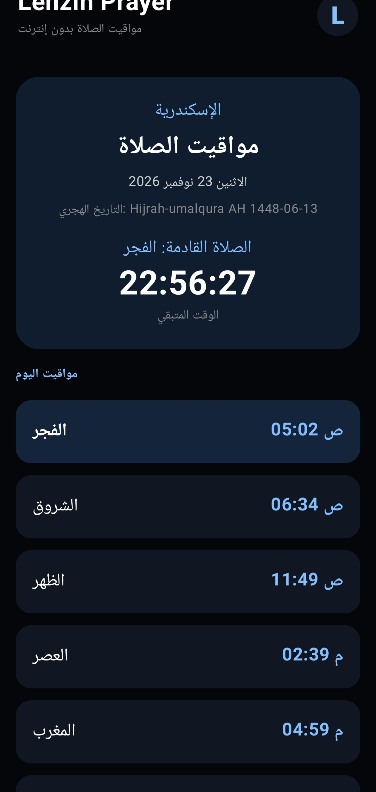

# LaZine Prayer

🇪🇬 **الوصف بالعربية**

LaZine Prayer هو تطبيق مجاني ومفتوح المصدر لمواقيت الصلاة، صُمم ليكون بسيطًا وآمنًا وخاليًا من الإعلانات.

- 🆓 مجاني بالكامل، بدون اشتراكات أو إعلانات.
- 🔓 مفتوح المصدر، ويمكن للجميع مراجعة الكود البرمجي.
- 🔒 لا يحتاج إلى اتصال بالإنترنت لحساب مواقيت الصلاة.
- 🛡️ لا يحتوي على إعلانات أو أدوات تتبع مدمجة.
- ✅ نتائج فحص Google Play Protect مرفقة في الصور أدناه.

هدفنا تقديم تطبيق موثوق يحترم خصوصية المستخدم ويمنحه تجربة واضحة وخالية من الإزعاج.

🇬🇧 **English Description**

LaZine Prayer is a free and open-source prayer times application, designed to be simple, privacy-friendly, and completely ad-free.

- 🆓 100% free — no subscriptions or advertisements.
- 🔓 Open source — anyone can review the source code.
- 🔒 Works offline to calculate prayer times.
- 🛡️ No built-in ads or tracking tools.
- ✅ Google Play Protect scan results are provided in the screenshots below.

Our goal is to provide a reliable prayer times app that respects user privacy and offers a clean, distraction-free experience.

---

## 🛡️ Security & Transparency | الأمان والشفافية

The screenshots below show the security scan results from Google Play Protect for the tested APK. We encourage users to review the source code and verify the APK before installation.

الصور أدناه تعرض نتائج فحص Google Play Protect لملف APK الذي تم اختباره. نشجع المستخدمين على مراجعة الكود المصدري والتحقق من ملف APK قبل التثبيت.

**Permission transparency:** The only runtime permission prompt requested by the app is Android's notification permission (`POST_NOTIFICATIONS`). The manifest also declares system permissions used for exact alarm scheduling, rescheduling after reboot and Adhan foreground playback; these are not additional runtime permission prompts. The app does not request location, contacts, microphone, camera or storage permissions, and it does not declare `INTERNET`.

**Privacy audit:** The current source and Gradle dependencies were reviewed: the project uses AndroidX/Jetpack Compose libraries and contains no integrated advertising, analytics or tracking SDKs. Prayer calculations and settings are handled locally on the device. This is a source-level review, not a mathematical guarantee about every future APK; the Google Play Protect screenshot documents only the exact APK that was scanned. No scanner can certify an app as 100% risk-free.

## 📸 Screenshots | لقطات الشاشة

### App interface


### Notification permission


### Google Play Protect


## ✨ Features | المميزات

- Offline prayer-time calculations.
- Alexandria, Cairo and Makkah presets.
- Egyptian Survey, MWL and ISNA calculation methods.
- Standard and Hanafi Asr settings.
- Arabic and English interface.
- Full Adhan, short tone, notification, silent and off modes.
- Custom audio file selection.
- Next-prayer countdown and selectable prayer countdown.

## 👨‍💻 Developer | المطور

**ZineFather** — Android developer, Samsung ROM maintainer and founder of ZineROM.

مطور أندرويد ورومات Samsung ومؤسس ZineROM، يهتم بتطوير أدوات وتطبيقات أندرويد وتحسين دعم الأجهزة وتجربة الاستخدام.

- Telegram: [@ZineFather](https://t.me/ZineFather)
- Bug reports: [Report a bug](https://t.me/ZineROMProject/9)
- Source code: [GitHub repository](https://github.com/ZineFather/LaZine-Prayer)

## App details

- Package: `com.zine.prayer`
- Minimum Android: 8.0 (API 26)
- Current version: 4.6.3

## Build from source

```bash
gradle :app:assembleDebug
```

GitHub Actions builds the APK from `main` and publishes it in GitHub Releases. GitHub also provides source-code archives automatically.
